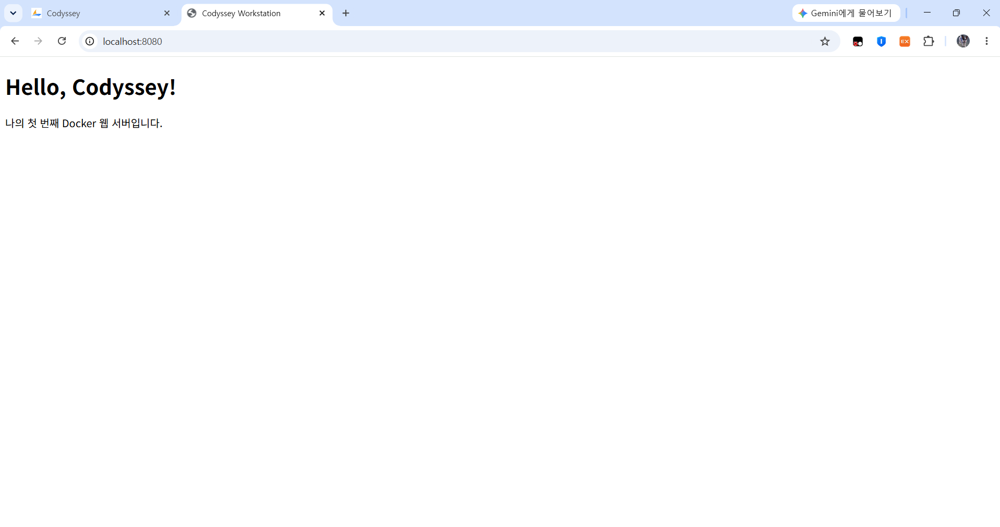
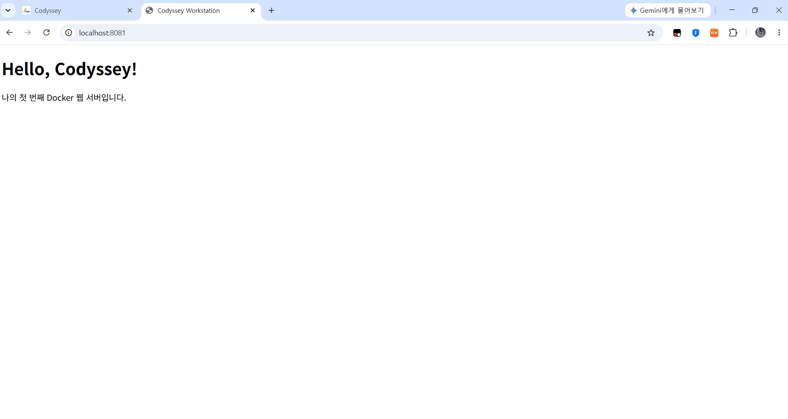
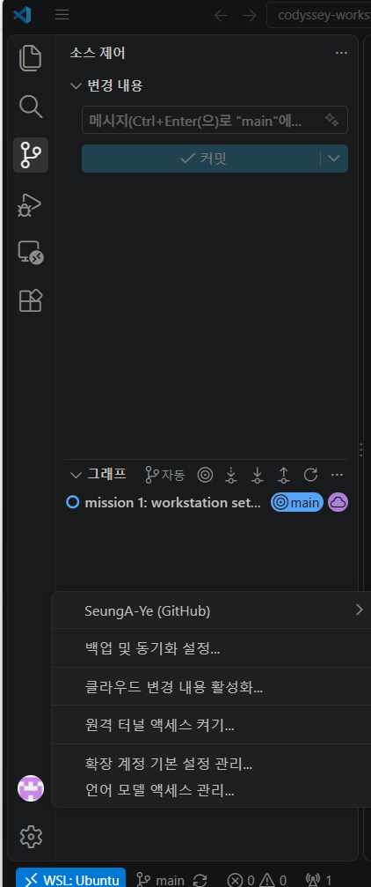
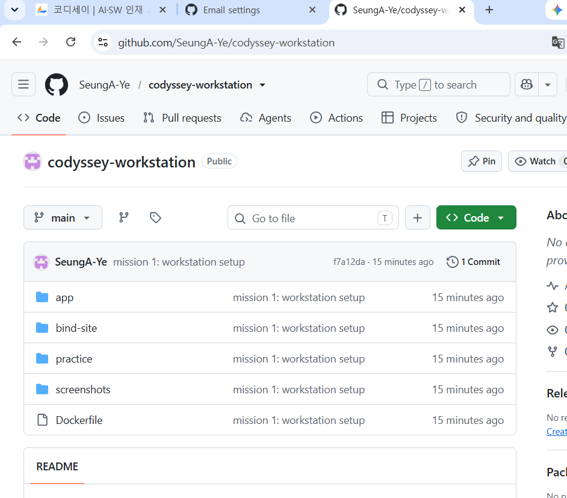

# Codyssey 미션 1 — 개발 워크스테이션 구축

터미널(Linux CLI), Docker, Git/GitHub를 직접 세팅하고, 각 기능이 동작함을 **실행 결과(로그·접속·데이터 유지)** 로 검증한 기록입니다.

## 목차
1. [프로젝트 개요](#1-프로젝트-개요)
2. [실행 환경](#2-실행-환경)
3. [수행 항목 체크리스트](#3-수행-항목-체크리스트)
4. [저장소 구조](#4-저장소-구조)
5. [터미널 조작 · 권한 실습](#5-터미널-조작--권한-실습)
6. [Docker 설치 및 점검](#6-docker-설치-및-점검)
7. [Docker 기본 운영 · 컨테이너 실습](#7-docker-기본-운영--컨테이너-실습)
8. [Dockerfile 커스텀 이미지 · 포트 매핑](#8-dockerfile-커스텀-이미지--포트-매핑)
9. [바인드 마운트 · 볼륨 영속성](#9-바인드-마운트--볼륨-영속성)
10. [Git 설정 · GitHub/VSCode 연동](#10-git-설정--githubvscode-연동)
11. [트러블슈팅](#11-트러블슈팅)
12. [핵심 개념 정리](#12-핵심-개념-정리)
13. [재현 방법 · 주의사항](#13-재현-방법--주의사항)
14. [보안 · 개인정보 처리](#14-보안--개인정보-처리)

---

## 1. 프로젝트 개요

| 목표 | 검증 방법 |
|---|---|
| 터미널로 디렉토리·파일·권한을 다룬다 | 명령 + 출력 로그, 권한 변경 전/후 비교 |
| Docker를 점검하고 컨테이너를 운영한다 | `docker info`, `ps`, `logs`, `stats` 출력 |
| 기존 이미지(nginx:alpine)를 기반으로 커스텀 이미지를 만든다 | Dockerfile, 빌드 로그 |
| 포트 매핑으로 외부에서 접속한다 | `curl` 응답 + 브라우저 캡처(주소창 포함) |
| 바인드 마운트로 "변경 반영", 볼륨으로 "데이터 영속성"을 증명한다 | 변경 전/후, 컨테이너 삭제 전/후 비교 |
| Git/GitHub로 결과물을 버전 관리하고 공유한다 | `git config --list`, VSCode 로그인 캡처, 공개 저장소 |

---

## 2. 실행 환경

| 항목 | 값 |
|---|---|
| Host OS | Windows (교육장 PC) |
| Linux 환경 | WSL2 Ubuntu — 커널 `6.18.54.1-microsoft-standard-WSL2`, x86_64 |
| 진입 터미널 | Windows PowerShell 5.1 → `wsl` 명령으로 Ubuntu 진입 |
| Shell | `/bin/bash` |
| Docker | Docker Desktop (WSL Integration 활성화), Client/Server `29.9.2` |
| Docker Compose | `v5.6.1` (플러그인) |
| Git | `2.53.0` (WSL Ubuntu 내부) |
| Editor | VSCode + WSL 확장 (`WSL: Ubuntu` 원격 모드) |
| 작업 경로 | `~/codyssey-workstation` (Linux 홈 영역) |

```bash
$ uname -a
Linux DESKTOP-NG9CK1C 6.18.54.1-microsoft-standard-WSL2 #1 SMP PREEMPT_DYNAMIC Tue Oct  6 19:13:07 UTC 2026 x86_64 GNU/Linux
$ echo $SHELL
/bin/bash
$ docker --version
Docker version 29.9.2, build a82e528
$ git --version
git version 2.53.0
```

---

## 3. 수행 항목 체크리스트

- [x] 터미널 기본 조작 및 폴더 구성 → [5장](#5-터미널-조작--권한-실습)
- [x] 권한 변경 실습 (파일 1개, 디렉토리 1개) → [5장](#5-터미널-조작--권한-실습)
- [x] Docker 설치·데몬 점검 → [6장](#6-docker-설치-및-점검)
- [x] hello-world 실행 → [7장](#7-docker-기본-운영--컨테이너-실습)
- [x] 이미지 다운로드·목록 / 컨테이너 실행·중지·목록 / 로그·리소스 확인 → [7장](#7-docker-기본-운영--컨테이너-실습)
- [x] ubuntu 컨테이너 내부 진입 및 명령 실행 → [7장](#7-docker-기본-운영--컨테이너-실습)
- [x] attach / exec 차이 관찰 → [7장](#7-docker-기본-운영--컨테이너-실습)
- [x] Dockerfile 작성·빌드·실행 (커스텀 이미지) → [8장](#8-dockerfile-커스텀-이미지--포트-매핑)
- [x] 포트 매핑 접속 2회 (8080, 8081) → [8장](#8-dockerfile-커스텀-이미지--포트-매핑)
- [x] 바인드 마운트 변경 반영 → [9장](#9-바인드-마운트--볼륨-영속성)
- [x] Docker 볼륨 영속성 → [9장](#9-바인드-마운트--볼륨-영속성)
- [x] Git 사용자 정보·기본 브랜치 설정 → [10장](#10-git-설정--githubvscode-연동)
- [x] VSCode GitHub 로그인 및 저장소 연동 → [10장](#10-git-설정--githubvscode-연동)
- [x] 트러블슈팅 2건 이상 (4건) → [11장](#11-트러블슈팅)

---

## 4. 저장소 구조

```
codyssey-workstation/
├── README.md                       # 본 기술 문서
├── Dockerfile                      # 커스텀 nginx 이미지 정의
├── app/index.html                  # 커스텀 이미지에 담긴 정적 웹 페이지
├── bind-site/index.html            # 바인드 마운트 실습용 호스트 파일 (최종: v2)
├── practice/                       # 터미널·권한 실습 산출물
├── docs/01-terminal-permissions.md # 터미널·권한 실습 전체 로그
└── screenshots/                    # 브라우저 접속, VSCode 연동 증거
```

> `practice/perm-dir`는 빈 디렉토리여서 Git이 추적하지 않습니다(Git은 파일만 기록). 권한 변경 결과는 로그로 확인합니다.

---

## 5. 터미널 조작 · 권한 실습

전체 로그: **[docs/01-terminal-permissions.md](docs/01-terminal-permissions.md)**

| 요구 동작 | 사용 명령 |
|---|---|
| 현재 위치 / 목록(숨김 포함) / 이동 | `pwd`, `ls -la`, `cd` |
| 생성 / 빈 파일 생성 | `mkdir -p`, `touch` |
| 복사 / 이동·이름변경 / 삭제 | `cp`, `mv`, `rm`, `rmdir` |
| 파일 내용 확인 | `cat` |

### 권한 변경 전/후 (요약)

```bash
$ ls -l perm-file.sh
-rw-r--r-- 1 seunga seunga 0 Nov  4 16:28 perm-file.sh
$ ls -ld perm-dir
drwxr-xr-x 2 seunga seunga 4096 Nov  4 16:28 perm-dir
$ chmod 755 perm-file.sh
$ chmod 700 perm-dir
$ ls -l perm-file.sh
-rwxr-xr-x 1 seunga seunga 0 Nov  4 16:28 perm-file.sh
$ ls -ld perm-dir
drwx------ 2 seunga seunga 4096 Nov  4 16:28 perm-dir
```

| 대상 | 변경 전 | 변경 후 | 의미 |
|---|---|---|---|
| 파일 `perm-file.sh` | 644 `rw-r--r--` | 755 `rwxr-xr-x` | 모든 사용자에게 실행(x) 권한 추가 |
| 디렉토리 `perm-dir` | 755 `rwxr-xr-x` | 700 `rwx------` | 소유자 외 접근 차단 |

---

## 6. Docker 설치 및 점검

Docker Desktop이 설치되어 있었으며, WSL Integration을 켜서 Ubuntu에서 사용 가능하게 했습니다([트러블슈팅 2](#ts-2) 참고).

```bash
$ docker --version
Docker version 29.9.2, build a82e528

$ docker info        # (Client 플러그인 목록, 고유 ID 등 일부 생략)
Client:
 Version:    29.9.2
 Context:    default
 ...
Server:
 Containers: 0
  Running: 0
  Paused: 0
  Stopped: 0
 Images: 0
 Server Version: 29.9.2
 Storage Driver: overlayfs
 Cgroup Version: 2
 Kernel Version: 6.18.54.1-microsoft-standard-WSL2
 Operating System: Docker Desktop
 OSType: linux
 Architecture: x86_64
 CPUs: 12
 Total Memory: 7.602GiB
 Name: docker-desktop
 ...
```

**판정:** `Server:` 섹션과 `Server Version`이 출력됨 → Docker 데몬(엔진)이 정상 동작 중. 초기 상태는 컨테이너 0, 이미지 0.

---

## 7. Docker 기본 운영 · 컨테이너 실습

### 7-1. hello-world 실행

```bash
$ docker run hello-world
Unable to find image 'hello-world:latest' locally
latest: Pulling from library/hello-world
4f55086f7dd0: Pull complete
d5e71e642bf5: Download complete
Digest: sha256:c567b231f65614688711a75f31518a064258a51d442117a3e771a3a8fdba78ef
Status: Downloaded newer image for hello-world:latest

Hello from Docker!
This message shows that your installation appears to be working correctly.
...
```

로컬에 이미지가 없으면 Docker Hub에서 받아(pull) → 컨테이너를 만들어 → 실행합니다. hello-world는 메시지를 출력한 뒤 스스로 종료됩니다.

### 7-2. 이미지 · 컨테이너 목록, 로그

```bash
$ docker images
IMAGE                ID             DISK USAGE   CONTENT SIZE   EXTRA
hello-world:latest   c567b231f656       25.9kB         9.49kB    U

$ docker ps
CONTAINER ID   IMAGE     COMMAND   CREATED   STATUS    PORTS     NAMES

$ docker ps -a
CONTAINER ID   IMAGE         COMMAND    CREATED         STATUS                     PORTS     NAMES
30fb39f8ba69   hello-world   "/hello"   2 minutes ago   Exited (0) 2 minutes ago             interesting_benz

$ docker logs interesting_benz
Hello from Docker!
This message shows that your installation appears to be working correctly.
...
```

- `docker ps`: 실행 중인 컨테이너만 → 비어 있음
- `docker ps -a`: 종료된 컨테이너 포함 → `Exited (0)` = 정상 종료
- 종료된 컨테이너도 삭제 전까지 남아 있으며 `docker logs`로 과거 출력을 다시 볼 수 있음

### 7-3. 이미지 다운로드(pull)

```bash
$ docker pull ubuntu
Using default tag: latest
latest: Pulling from library/ubuntu
f3f25b84a7d7: Pull complete
edafa32f5d9e: Pull complete
21594acc2d8b: Download complete
Digest: sha256:6a06111c3b0a8600feadb270aec771dc239bf407b25625f93f44ab00e11f4d3c
Status: Downloaded newer image for ubuntu:latest
docker.io/library/ubuntu:latest

$ docker images
IMAGE                ID             DISK USAGE   CONTENT SIZE   EXTRA
hello-world:latest   c567b231f656       25.9kB         9.49kB    U
ubuntu:latest        6a06111c3b0a        163MB         45.9MB
```

`pull`은 이미지를 받기만 하고 실행하지 않습니다(`run`과의 차이).

### 7-4. ubuntu 컨테이너 내부 진입

```bash
$ docker run -it --name ubuntu-test ubuntu bash
root@9c5ddaecd8d2:/# ls
bin   dev  home  lib64  mnt  proc  run   srv  tmp  var
boot  etc  lib   media  opt  root  sbin  sys  usr
root@9c5ddaecd8d2:/# echo "hello from container"
hello from container
root@9c5ddaecd8d2:/# exit
exit
$ docker ps -a
CONTAINER ID   IMAGE         COMMAND    CREATED          STATUS                      PORTS     NAMES
9c5ddaecd8d2   ubuntu        "bash"     2 minutes ago    Exited (0) 15 seconds ago             ubuntu-test
30fb39f8ba69   hello-world   "/hello"   11 minutes ago   Exited (0) 11 minutes ago             interesting_benz
```

- 프롬프트의 `9c5ddaecd8d2`는 컨테이너 ID와 동일 → 컨테이너 내부에 있음을 의미
- `ls` 결과에 호스트의 작업 폴더가 보이지 않음 → **격리된 파일시스템**
- `exit` 후 즉시 `Exited` → 컨테이너는 **메인 프로세스(bash)가 살아 있는 동안만 실행**됨

### 7-5. 실행 · 리소스 확인 · exec vs attach · 시작/중지

```bash
$ docker start ubuntu-keep          # (-dit로 생성해 둔 컨테이너)
ubuntu-keep
$ docker ps
CONTAINER ID   IMAGE     COMMAND   CREATED         STATUS         PORTS     NAMES
4374c6ad22aa   ubuntu    "bash"    3 minutes ago   Up 3 minutes             ubuntu-keep

$ docker stats --no-stream
CONTAINER ID   NAME          CPU %     MEM USAGE / LIMIT     MEM %     NET I/O         BLOCK I/O   PIDS
4374c6ad22aa   ubuntu-keep   0.00%     1.383MiB / 7.602GiB   0.02%     1.17kB / 126B   0B / 0B     1

$ docker exec -it ubuntu-keep bash
root@4374c6ad22aa:/# exit
exit
$ docker ps
CONTAINER ID   IMAGE     COMMAND   CREATED         STATUS         PORTS     NAMES
4374c6ad22aa   ubuntu    "bash"    3 minutes ago   Up 3 minutes             ubuntu-keep

$ docker attach ubuntu-keep
root@4374c6ad22aa:/# exit
exit
$ docker ps -a
CONTAINER ID   IMAGE         COMMAND    CREATED          STATUS                      PORTS     NAMES
4374c6ad22aa   ubuntu        "bash"     4 minutes ago    Exited (0) 4 seconds ago              ubuntu-keep
...

$ docker start ubuntu-keep
ubuntu-keep
$ docker stop ubuntu-keep
ubuntu-keep
$ docker ps -a
CONTAINER ID   IMAGE         COMMAND    CREATED          STATUS                       PORTS     NAMES
4374c6ad22aa   ubuntu        "bash"     4 minutes ago    Exited (137) 2 seconds ago             ubuntu-keep
...
```

**관찰 결과: exec vs attach**

| 방식 | 동작 | `exit` 후 컨테이너 |
|---|---|---|
| `docker exec -it <이름> bash` | 컨테이너 안에 **새 bash 프로세스를 추가로** 실행해 접속 | **Up 유지** — 추가 프로세스만 종료, 메인 bash는 그대로 |
| `docker attach <이름>` | 이미 실행 중인 **메인 프로세스(bash)에 직접** 연결 | **Exited** — 메인 프로세스가 종료되어 컨테이너도 종료 |

→ 운영 중인 컨테이너를 점검할 때는 `exec`를 쓰는 것이 안전합니다.
→ `Exited (137)`은 `docker stop`이 프로세스를 강제 종료(SIGKILL)했을 때의 코드입니다.

---

## 8. Dockerfile 커스텀 이미지 · 포트 매핑

### 8-1. 선택한 방식

**(A) 웹 서버 베이스 이미지 활용** — 공식 `nginx:alpine` 이미지 위에 정적 콘텐츠를 교체하고 메타데이터·헬스체크를 추가했습니다.

### 8-2. Dockerfile

```dockerfile
FROM nginx:alpine
LABEL org.opencontainers.image.title="codyssey-web" \
      org.opencontainers.image.description="Codyssey mission 1 custom nginx"
COPY app/ /usr/share/nginx/html/
EXPOSE 80
HEALTHCHECK --interval=30s --timeout=3s CMD wget -q -O /dev/null http://127.0.0.1/ || exit 1
```

| 커스텀 포인트 | 목적 |
|---|---|
| `FROM nginx:alpine` | 검증된 공식 웹 서버 이미지를 베이스로 사용. alpine 기반이라 용량이 작음 |
| `LABEL` | 이미지 이름·설명 메타데이터 기록 → `docker inspect`로 식별 가능 |
| `COPY app/ ...` | nginx 기본 페이지를 직접 작성한 `app/index.html`로 교체 |
| `EXPOSE 80` | 컨테이너가 80번 포트를 사용함을 문서화 |
| `HEALTHCHECK` | 30초마다 자기 자신에게 요청을 보내 웹 서버 생존 여부를 자동 점검 → `docker ps`에 `(healthy)` 표시 |

### 8-3. 빌드

```bash
$ docker build -t codyssey-web:1.0 .
[+] Building 9.4s (7/7) FINISHED                             docker:default
 => [internal] load build definition from Dockerfile                   0.0s
 => [internal] load metadata for docker.io/library/nginx:alpine        2.7s
 => [internal] load .dockerignore                                      0.0s
 => [internal] load build context                                      0.1s
 => [1/2] FROM docker.io/library/nginx:alpine@sha256:785835ea65db4bba  5.3s
 => [2/2] COPY app/ /usr/share/nginx/html/                             0.1s
 => exporting to image                                                 1.0s
 => => naming to docker.io/library/codyssey-web:1.0                    0.0s

$ docker images
IMAGE                ID             DISK USAGE   CONTENT SIZE   EXTRA
codyssey-web:1.0     bda86c31ef20       93.6MB         26.3MB
hello-world:latest   c567b231f656       25.9kB         9.49kB    U
ubuntu:latest        6a06111c3b0a        163MB         45.9MB    U
```

### 8-4. 포트 매핑 실행 (2회)

```bash
$ docker run -d -p 8080:80 --name web-8080 codyssey-web:1.0
eed93d7ea4236ff3f440e77e76a27f4d62c7364799d4447cacb1ff899db1ed05
$ docker run -d -p 8081:80 --name web-8081 codyssey-web:1.0
2dcd7a02b35eb0cda63c162f1da94fba053f4647e95a97f8dc53c83053f80113

$ docker ps
CONTAINER ID   IMAGE              COMMAND                  CREATED         STATUS                                     PORTS                                     NAMES
2dcd7a02b35e   codyssey-web:1.0   "/docker-entrypoint.…"   1 second ago    Up Less than a second (health: starting)   0.0.0.0:8081->80/tcp, [::]:8081->80/tcp   web-8081
eed93d7ea423   codyssey-web:1.0   "/docker-entrypoint.…"   2 seconds ago   Up 1 second (health: starting)             0.0.0.0:8080->80/tcp, [::]:8080->80/tcp   web-8080

$ curl http://localhost:8080
<!DOCTYPE html>
<html lang="ko">
<head><meta charset="UTF-8"><title>Codyssey Workstation</title></head>
<body>
  <h1>Hello, Codyssey!</h1>
  <p>나의 첫 번째 Docker 웹 서버입니다.</p>
</body>
</html>

$ curl http://localhost:8081
(8080과 동일한 HTML 응답)
```

약 5분 후 상태 및 nginx 접근 로그:

```bash
$ docker ps
...  Up 5 minutes (healthy)   0.0.0.0:8081->80/tcp, [::]:8081->80/tcp   web-8081
...  Up 5 minutes (healthy)   0.0.0.0:8080->80/tcp, [::]:8080->80/tcp   web-8080

$ docker logs web-8080 2>&1 | tail -5
172.17.0.1 - - [04/Nov/2026:08:04:58 +0000] "GET / HTTP/1.1" 304 0 "-" "Mozilla/5.0 (Windows NT 10.0; Win64; x64) ... Chrome/156.0.0.0 Safari/537.36" "-"
127.0.0.1 - - [04/Nov/2026:08:05:02 +0000] "GET / HTTP/1.1" 200 210 "-" "Wget" "-"
127.0.0.1 - - [04/Nov/2026:08:05:32 +0000] "GET / HTTP/1.1" 200 210 "-" "Wget" "-"
...
```

- 첫 줄: Windows 크롬 브라우저의 실제 접속 기록
- `Wget` 줄: 30초 간격 HEALTHCHECK 요청 → `(healthy)` 상태의 근거

### 8-5. 브라우저 접속 증거

| http://localhost:8080 | http://localhost:8081 |
|---|---|
|  |  |

같은 이미지로 만든 컨테이너 2개를 **호스트의 서로 다른 포트(8080, 8081)** 에 연결해 각각 접속했습니다. 컨테이너 내부 포트는 둘 다 80입니다.

---

## 9. 바인드 마운트 · 볼륨 영속성

### 9-1. 바인드 마운트 — 호스트 변경이 컨테이너에 즉시 반영

```bash
$ mkdir -p bind-site
$ echo '<h1>BEFORE: host file v1</h1>' > bind-site/index.html
$ docker run -d -p 8082:80 --name bind-test -v /home/seunga/codyssey-workstation/bind-site:/usr/share/nginx/html nginx:alpine
0298d9ab6482e0e0cf4ea24954d668cce76d7bd4c74e2c04ca62f6a5e179ce58

$ curl http://localhost:8082                       # 변경 전
<h1>BEFORE: host file v1</h1>

$ echo '<h1>AFTER: host file v2</h1>' > bind-site/index.html   # 호스트에서만 수정

$ curl http://localhost:8082                       # 변경 후 (컨테이너 재시작 없음)
<h1>AFTER: host file v2</h1>

$ docker exec bind-test cat /usr/share/nginx/html/index.html   # 컨테이너 내부에서 확인
<h1>AFTER: host file v2</h1>
```

**판정:** 컨테이너를 다시 만들거나 재시작하지 않았는데 호스트 파일 수정이 즉시 반영됨 → 호스트 폴더와 컨테이너 폴더가 **같은 실제 파일을 공유**함.

### 9-2. Docker 볼륨 — 컨테이너 삭제 후에도 데이터 유지

```bash
$ docker volume create codyssey-data
codyssey-data
$ docker volume ls
DRIVER    VOLUME NAME
local     codyssey-data

# [1] 쓰기용 컨테이너에 볼륨 연결 후 데이터 기록
$ docker run -d --name vol-writer -v codyssey-data:/data ubuntu sleep infinity
52f2fbdcffca62062173e7570535ec17064ce4c8626e28ea2a4ef88754cf19d3
$ docker exec vol-writer bash -c 'echo "saved at $(date)" > /data/record.txt && cat /data/record.txt'
saved at Wed Nov  4 08:07:01 UTC 2026

# [2] 컨테이너 삭제
$ docker rm -f vol-writer
vol-writer
$ docker ps -a          # vol-writer가 목록에서 사라짐
CONTAINER ID   IMAGE              COMMAND                  CREATED          STATUS                       PORTS                                     NAMES
0298d9ab6482   nginx:alpine       "/docker-entrypoint.…"   4 seconds ago    Up 3 seconds                 0.0.0.0:8082->80/tcp, [::]:8082->80/tcp   bind-test
2dcd7a02b35e   codyssey-web:1.0   "/docker-entrypoint.…"   5 minutes ago    Up 5 minutes (healthy)       0.0.0.0:8081->80/tcp, [::]:8081->80/tcp   web-8081
eed93d7ea423   codyssey-web:1.0   "/docker-entrypoint.…"   6 minutes ago    Up 5 minutes (healthy)       0.0.0.0:8080->80/tcp, [::]:8080->80/tcp   web-8080
4374c6ad22aa   ubuntu             "bash"                   12 minutes ago   Exited (137) 8 minutes ago                                             ubuntu-keep
9c5ddaecd8d2   ubuntu             "bash"                   17 minutes ago   Exited (0) 15 minutes ago                                              ubuntu-test
30fb39f8ba69   hello-world        "/hello"                 26 minutes ago   Exited (0) 26 minutes ago                                              interesting_benz

# [3] 새 컨테이너에 같은 볼륨 연결 후 데이터 확인
$ docker run -d --name vol-reader -v codyssey-data:/data ubuntu sleep infinity
3eb6cb4376215f2ee5328d661874543b8254c50459bc425bf657ee8a0504574c
$ docker exec vol-reader cat /data/record.txt
saved at Wed Nov  4 08:07:01 UTC 2026

$ docker volume inspect codyssey-data
[
    {
        "CreatedAt": "2026-11-04T08:07:00Z",
        "Driver": "local",
        "Labels": null,
        "Mountpoint": "/var/lib/docker/volumes/codyssey-data/_data",
        "Name": "codyssey-data",
        "Options": null,
        "Scope": "local"
    }
]
```

**판정:** `vol-writer`를 삭제한 뒤 새로 만든 `vol-reader`에서 **같은 타임스탬프(08:07:01)의 데이터**가 확인됨 → 데이터는 컨테이너가 아니라 볼륨(`/var/lib/docker/volumes/...`)에 저장되어 있음.

| 구분 | 바인드 마운트 | 볼륨 |
|---|---|---|
| 저장 위치 | 내가 지정한 호스트 폴더 | Docker가 관리하는 영역 |
| 주 용도 | 개발 중 코드·설정 실시간 반영 | DB 등 운영 데이터 보존 |
| 이번 실습에서 증명한 것 | 변경 반영 | 컨테이너 삭제 후 영속성 |

---

## 10. Git 설정 · GitHub/VSCode 연동

### 10-1. Git 사용자 정보 · 기본 브랜치

```bash
$ git config --global user.name "SeungA-Ye"
$ git config --global user.email "351345578+SeungA-Ye@users.noreply.github.com"
$ git config --global init.defaultBranch main
$ git config --list
user.name=SeungA-Ye
user.email=351345578+SeungA-Ye@users.noreply.github.com
init.defaultbranch=main
```

- 이메일은 GitHub가 제공하는 **noreply 주소**를 사용해 실제 이메일 노출을 방지했습니다.

### 10-2. VSCode GitHub 로그인 · 저장소 연동

1. WSL Ubuntu에서 `code .` → VSCode를 **`WSL: Ubuntu` 원격 모드**로 실행
2. 소스 제어 → 리포지토리 초기화 → 커밋 `mission 1: workstation setup`
3. 분기 게시(Publish Branch) → GitHub 로그인 승인 → **public repository**로 게시

| VSCode GitHub 로그인 상태 | GitHub 공개 저장소 |
|---|---|
|  |  |

---

## 11. 트러블슈팅

<a id="ts-1"></a>
### ① PowerShell에서 리눅스 명령 인식 불가

| 단계 | 내용 |
|---|---|
| 문제 | `uname -a` 실행 시 `'uname' 용어가 cmdlet ... 인식되지 않습니다` 오류. `echo $SHELL`은 빈 줄 출력 |
| 원인 가설 | 리눅스 명령을 Windows 기본 셸(PowerShell)에서 실행했기 때문 |
| 확인 | 터미널 첫 줄이 `Windows PowerShell 5.1` / `wsl -l -v`로 `Ubuntu (VERSION 2)` 설치 확인 |
| 해결 | `wsl`로 Ubuntu에 진입해 bash 환경에서 작업. Git Bash는 Windows 파일시스템(NTFS)에서 `chmod`가 실제 반영되지 않아 권한 실습이 불가능하므로 제외 |

<a id="ts-2"></a>
### ② WSL Ubuntu에서 `docker` 명령을 찾을 수 없음

| 단계 | 내용 |
|---|---|
| 문제 | `The command 'docker' could not be found in this WSL 2 distro.` |
| 원인 가설 | Docker Desktop이 Windows에만 연결되어 있고 Ubuntu 배포판과는 연동되지 않음 |
| 확인 | 오류 메시지에 `activate the WSL integration in Docker Desktop settings` 안내. PowerShell에서는 `docker --version` 정상 |
| 해결 | Docker Desktop → Settings → Resources → WSL Integration → Ubuntu 활성화 → Apply & Restart → `docker info`에 `Server:` 섹션 출력 확인 |

<a id="ts-3"></a>
### ③ 컨테이너 이름 충돌

| 단계 | 내용 |
|---|---|
| 문제 | `docker run ... --name ubuntu-keep` 실행 시 `Conflict. The container name "/ubuntu-keep" is already in use` |
| 원인 가설 | 같은 이름의 컨테이너가 이미 생성되어 있음(이전 실행) |
| 확인 | 오류 메시지에 기존 컨테이너 ID `4374c6ad22aa...` 명시 |
| 해결 | 새로 만들지 않고 `docker start ubuntu-keep`으로 기존 컨테이너 재사용. (새로 만들려면 `docker rm -f ubuntu-keep` 후 재실행) |

<a id="ts-4"></a>
### ④ VSCode가 WSL이 아닌 Windows 모드로 열림

| 단계 | 내용 |
|---|---|
| 문제 | `code .` 실행 후 VSCode 왼쪽 아래에 `WSL: Ubuntu` 표시가 없음 |
| 원인 가설 | VSCode에 WSL 확장이 없어 Windows 측에서 네트워크 경로(`\\wsl.localhost\...`)로 폴더를 열었음. 이 경우 Ubuntu가 아닌 Windows Git과 그 설정이 사용됨 |
| 확인 | 원격 표시기가 비어 있음 / 확장 마켓플레이스에서 WSL 미설치 확인 |
| 해결 | Microsoft `WSL` 확장 설치 → `WSL에서 폴더 다시 열기` → 제목줄·상태바에 `WSL: Ubuntu` 표시 확인 |

**기타:** `set -x`로 로그를 기록할 때 Ubuntu 프롬프트 훅(`__systemd_osc_context_ps0`)의 내부 추적 줄과 machine-id가 함께 출력됨 → `PS0=''`로 훅을 비활성화한 뒤 기록하고, 이미 기록된 줄은 문서에서 제거.

---

## 12. 핵심 개념 정리

### 절대 경로 vs 상대 경로
- **절대 경로**: 루트(`/`)부터 시작하는 전체 주소. 예) `cd /home/seunga/codyssey-workstation` — 어느 위치에서 실행해도 같은 곳으로 이동
- **상대 경로**: 현재 위치를 기준으로 한 주소. 예) `/home/seunga/codyssey-workstation`에서 `cd practice` — 다른 위치에서 실행하면 실패. `..`은 상위 폴더, `.`은 현재 폴더

### 파일 권한 (r/w/x, 755/644)
- 세 자리 = 소유자(owner) / 그룹(group) / 기타(others)
- 각 자리 = r(읽기) 4 + w(쓰기) 2 + x(실행) 1 의 합
- `644` = `rw-r--r--` → 소유자만 수정, 나머지는 읽기 (일반 파일)
- `755` = `rwxr-xr-x` → 소유자만 수정, 모두 읽기·실행 (스크립트, 디렉토리)
- 디렉토리의 x = 그 안으로 들어갈(`cd`) 수 있는 권한

### 이미지 vs 컨테이너
- **이미지**: 실행에 필요한 파일·설정을 묶은 읽기 전용 틀
- **컨테이너**: 이미지로 만든 실행 인스턴스. 하나의 이미지로 여러 컨테이너 생성 가능(8080/8081 실습)
- 컨테이너는 **메인 프로세스가 살아 있는 동안만 실행**됨

### 커스텀 이미지
- 기존 이미지(`FROM`) 위에 내 파일·설정을 덧붙여 새 이미지를 만드는 것. 처음부터 만들지 않고 검증된 베이스를 재사용

### 포트 매핑이 필요한 이유
- 컨테이너는 격리된 네트워크를 가지므로 내부 80번 포트는 외부에서 직접 접근 불가
- `-p 호스트포트:컨테이너포트`로 호스트의 문과 컨테이너의 문을 연결해야 브라우저에서 접속 가능
- 호스트 포트만 다르게 하면 같은 이미지를 여러 개 동시에 띄울 수 있음

### Docker 볼륨
- 컨테이너 바깥(Docker 관리 영역)에 저장되는 데이터 공간
- 컨테이너는 삭제·재생성되는 일회용이지만, 볼륨의 데이터는 남음 → DB·업로드 파일 등 보존용

### Git vs GitHub
- **Git**: 내 컴퓨터에서 변경 이력을 기록하는 **로컬 버전 관리 도구**
- **GitHub**: Git 저장소를 인터넷에 올려 공유·협업하는 **원격 플랫폼**

---

## 13. 재현 방법 · 주의사항

### 사전 조건
- Windows: WSL2 + Ubuntu, Docker Desktop(WSL Integration 활성화), VSCode + WSL 확장
- Linux/macOS: Docker Engine 또는 Docker Desktop, Git

### 실행 절차

```bash
git clone https://github.com/SeungA-Ye/codyssey-workstation.git
cd codyssey-workstation

# 커스텀 이미지 빌드 · 실행
docker build -t codyssey-web:1.0 .
docker run -d -p 8080:80 --name web-8080 codyssey-web:1.0
docker run -d -p 8081:80 --name web-8081 codyssey-web:1.0
curl http://localhost:8080

# 바인드 마운트
docker run -d -p 8082:80 --name bind-test -v "$(pwd)/bind-site":/usr/share/nginx/html nginx:alpine
curl http://localhost:8082
echo "<h1>changed</h1>" > bind-site/index.html
curl http://localhost:8082

# 볼륨
docker volume create codyssey-data
docker run -d --name vol-writer -v codyssey-data:/data ubuntu sleep infinity
docker exec vol-writer bash -c 'echo "saved at $(date)" > /data/record.txt'
docker rm -f vol-writer
docker run -d --name vol-reader -v codyssey-data:/data ubuntu sleep infinity
docker exec vol-reader cat /data/record.txt

# 정리
docker rm -f web-8080 web-8081 bind-test vol-reader
docker volume rm codyssey-data
```

### 주의사항
- **WSL 사용 시 작업 폴더를 Linux 홈(`~`)에 둘 것.** `/mnt/c/...`(Windows 드라이브)에서는 `chmod`가 반영되지 않음
- 8080~8082 포트를 다른 프로그램이 사용 중이면 `port is already allocated` 오류 → 호스트 포트 번호를 바꿔 실행
- 같은 이름의 컨테이너가 남아 있으면 이름 충돌 → `docker rm -f <이름>` 후 재실행
- 본 문서의 `/home/seunga` 경로는 작성자 환경 기준 → 재현 시 `$(pwd)` 또는 본인 홈 경로 사용

---

## 14. 보안 · 개인정보 처리

- Git 이메일은 GitHub noreply 주소 사용 (실제 이메일 비공개)
- GitHub 인증은 VSCode 브라우저 승인 방식 사용 → 토큰·비밀번호를 터미널이나 파일에 입력하지 않음
- `set -x` 로그에 포함된 machine-id, boot-id 등 기기 식별값은 문서에서 제거
- `docker info`의 고유 ID 등 불필요한 식별 정보는 생략
- 스크린샷에 비밀번호·토큰·인증 코드가 포함되지 않았음을 확인
